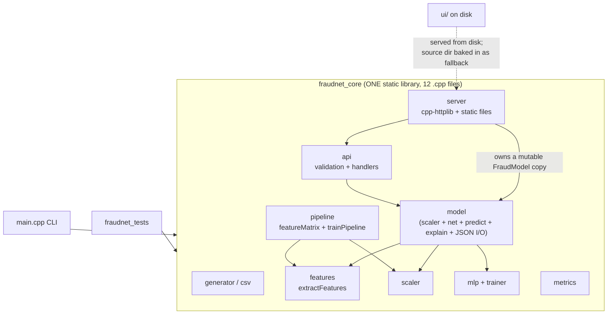
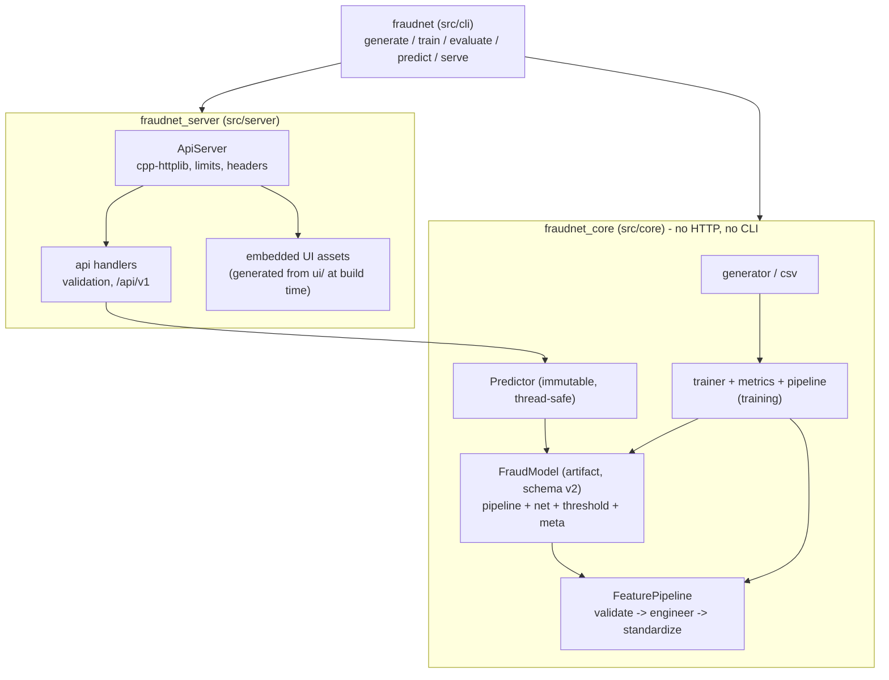

# FraudNet architecture review (v1.0.0 -> v1.1.0)

Scope: the whole repository at tag `v1.0.0` (about 2,300 lines of C++ plus a vanilla-JS UI). The review is
deliberately pragmatic: this is a portfolio-scale project, so the bar is "what a careful senior reviewer would
insist on before calling it production-shaped", not "enterprise ML platform".

Every claim in the original builder's list of weak spots was **verified in code or by experiment**, not assumed.
Some turned out to be partly wrong (see F-04, F-05, F-10) and are reported as such.

## 1. Architecture as found (v1.0.0)

What was good: clean math core (analytic gradients with a numerical gradient test, hand-rolled metrics),
deterministic seeded RNG, exhaustive request validation, stable-form sigmoid / softplus, sensible CLI.
What was not: the single library mixed ML code with the HTTP server, the UI and model had no packaging story,
and several invariants (feature contract, thread-safety, NaN-freedom) were true "by accident" instead of
being enforced by types, validation and tests.

## 2. Findings

Severity: **High** = breaks a core promise (portability, correctness contract) or leaks something;
**Medium** = real design/maintainability/robustness gap; **Low** = polish or conscious trade-off.

| ID | Sev | Issue | Why it matters | Fix / status |
| --- | --- | --- | --- | --- |
| F-01 | High | UI served from `ui/` on disk; `FRAUDNET_SOURCE_DIR` (absolute build-machine path) compiled into the library as a lookup fallback. | Binary is not relocatable (works only next to a checkout), leaks the build path, and "works on my machine" breaks on any other host. | **Fixed.** `ui/` is compiled into the binary by a pure-CMake generator (`cmake/embed_ui.cmake` -> `ui_assets_data.cpp`). `serve --ui DIR` remains as an explicit development override, `--no-ui` disables the UI. Baked path removed. Tested byte-for-byte against `ui/`. |
| F-02 | High | Model artifact had only `format: "fraudnet-model/1"`: no schema version, categories (one-hot order) not validated, no finite/threshold/activation checks, errors were bare `std::runtime_error`s. | The model file is the contract between training and serving. A reordered category list or NaN weight would load fine and silently produce wrong scores. | **Fixed.** Schema `2`: `format`, integer `schema_version`, ordered `features`, ordered `categories`, scaler, network, threshold. `FraudModel::fromJson` validates everything and throws `ModelError` with actionable messages ("features mismatch at position 1: model has ..., this build expects ..."; "schema_version 3 is newer than this build supports"; legacy v1 gets a retrain hint). Model retrained and recommitted. |
| F-03 | High | `fraudnet_core` contained `api.cpp`/`server.cpp`, so the ML core depended on cpp-httplib, sockets and `ws2_32`; no module directories. | Dependency direction was only a convention. Anyone reusing the model/trainer had to link an HTTP server. | **Fixed.** `src/core` (data, features, model, training, inference), `src/server` (API + HTTP + UI), `src/cli`. CMake targets `fraudnet_core` <- `fraudnet_server` <- `fraudnet`; core links only nlohmann_json, so the direction is compiler-enforced. |
| F-04 | Medium | Feature pipeline: raw -> engineered -> scaled was composed in two places (`pipeline.cpp::featureMatrix` for training, `FraudModel::predict` for serving). They shared `extractFeatures`, but nothing tied the two compositions together. | Classic training/serving-skew hazard: the next edit to one path silently diverges from the other. (Verified: today they were equivalent, so not a live bug.) | **Fixed.** `FeaturePipeline` (validate -> engineer -> standardize) is the only path; training builds matrices by calling the same per-row `transform(tx)` that serving calls, and the scaler lives inside the pipeline stored in the model. Tests: bit-for-bit row parity, golden feature values, golden model output. |
| F-05 | Medium | Thread safety of the model under concurrent HTTP requests. | The server held a copy of a mutable `FraudModel` (`setThreshold`, `meta()` non-const) and relied on handlers happening to be const. | **Verified safe in practice** (`forward()` only uses stack-local scratch; no shared mutable state), but unenforced. **Fixed by construction:** `Predictor` holds `shared_ptr<const FraudModel>`, exposes only const methods, and is the only thing the server owns. Tests: 8 threads x 1,000 predictions must equal single-threaded results exactly; 8 concurrent HTTP clients. |
| F-06 | Medium | Tests: `gtest_discover_tests` runs each case in its own process, and every case that touched the shared fixture re-trained a 20k-row model in that process; inference/API tests were coupled to the trainer. 40 tests took ~7.2 s. | Slow feedback, and a training regression broke unrelated API tests. | **Fixed.** Inference/API/serialization tests load a tiny committed model (`tests/data/test_model.json`, 20 KB). Training tests use a sub-second run. 63 tests in ~1.8 s; the training code can break without taking the API tests with it. |
| F-07 | Medium | NaN/domain guards: only the merchant category was checked in `extractFeatures`. CLI paths (`predict --csv`, `evaluate`, CSV with a negative amount) could feed `log1p(-1)` / NaN into the net and print a NaN probability; trainer did not detect divergence. | Silent NaN scores are the worst failure mode for a scoring service. | **Fixed.** `validateTransaction()` is called by `extractFeatures`, so every caller (API, CLI, training) rejects non-finite / out-of-domain input; `Predictor` throws if the score is non-finite; `Mlp::fromJson`/scaler reject non-finite parameters; trainer throws "training diverged" on a non-finite loss. Tests for each. |
| F-08 | Medium | API design: unversioned `/api/*`, one global 8 MiB body cap for every route, no `Content-Type` check, default socket timeouts. | Cannot evolve the API without breaking clients; a single-transaction endpoint should not accept megabytes. | **Fixed.** Canonical `/api/v1/{health,model,predict,predict/batch}`; old `/api/*` kept as aliases flagged with `Deprecation: true` and a `Link: ...; rel="successor-version"` header; UI moved to v1. Per-endpoint limits (`ServerOptions`: 4 MiB batch, 64 KiB single), JSON errors for 413 / 415, 10 s read/write timeouts. |
| F-09 | Medium | CMake: warning flags copy-pasted per target via a variable, no presets, no install rules, gtest always fetched, library target did everything. | Not reproducible by a newcomer; can't ship the binary + model; can't build without tests. | **Fixed.** `fraudnet_warnings` INTERFACE target (+ optional `FRAUDNET_WARNINGS_AS_ERRORS`), `FRAUDNET_BUILD_TESTS` option, `CMakePresets.json` (`msvc`, `msvc-strict`, `release`, `debug` + build/test presets), `install()` for binary, model and docs, model lookup also checks the installed `share/fraudnet/` layout. |
| F-10 | Low | Logistic regression is "an `Mlp` with no hidden layers". | Might look like a hack. | **Judged fine, left.** It is mathematically identical (single linear layer + the same stable BCE-from-logits), shares the gradient-checked backprop and the Adam trainer, and guarantees the baseline is trained exactly like the network. A separate class would add code without adding truth. |
| F-11 | Low | `sigmoid` was duplicated in two translation units. | Drift risk for the most numerically sensitive function. | **Fixed.** `numeric.hpp` (`sigmoid`, `softplus`), with extreme-value tests. The branch-stable forms (never `exp()` of a large positive number; BCE computed from logits via softplus, i.e. the two-class log-sum-exp trick) already made probability clamping unnecessary, so none was added. |
| F-12 | Low | Reproducibility. | Needed to trust "same seed, same model". | **Verified, left.** All randomness goes through one hand-written xoshiro256** (identical across standard libraries), seeds flow into generator, split, init and shuffling, and are stored in the model metadata. Retraining after the refactor reproduced v1.0.0 metrics to the last printed digit. New test: same seed -> bit-identical weights. Only `created_at` is non-deterministic metadata. |
| F-13 | Low | Error handling style. | Mixed bare `runtime_error`/`invalid_argument`; cryptic `stol` errors on `--hidden 3x`. | **Partly fixed.** `ModelError` type, friendly `--hidden` parsing. Convention kept: library throws, CLI catches in `main` and exits 1, API converts to JSON errors. No error-code/`expected<>` layer (not worth it here). |
| F-14 | Low | Model discovery walks up from cwd / exe dir (`findUpward`). | Implicit magic. | **Kept as a convenience, made explicit:** `--model`, then `$FRAUDNET_MODEL`, then upward search, then `<prefix>/share/fraudnet/models/`. |
| F-15 | Low | `main.cpp` is a 270-line file with a hand-rolled argument parser and all commands. | Fine at this size; would warrant a `cli/` split or a parsing library if commands grow. | **Left.** |
| F-16 | Low | Server is loopback-only, no auth, TLS or rate limiting. | Correct for a local demo; not for the internet. | **Left on purpose** (documented). Putting it behind a reverse proxy is the intended deployment. |
| F-17 | Low | Batch scoring and occlusion explanations are single-threaded (O(11) extra forward passes per transaction). | Throughput ceiling of a few thousand tx/s per request. | **Left.** Measured need is zero at this scale; `Predictor` is thread-safe, so a parallel `predictBatch` is a local change if ever needed. |
| F-18 | Low | Model metadata is untyped `nlohmann::json`; API error envelope is a flat custom shape (not RFC 7807); no CI config. | Convenience trade-offs. | **Left** (no remote, no pipeline to attach CI to). |

## 3. Architecture after the review (v1.1.0)

Dependency rules (enforced by CMake targets): `core` depends on nothing but nlohmann_json; `server` depends on
`core` and cpp-httplib; the CLI depends on both; tests depend on `server` (and thereby `core`).
Training and serving call the same `FeaturePipeline::transform(tx)`; the server only ever sees a `Predictor`.

## 4. Decisions

### Changed
* **Split into `core` / `server` / `cli` libraries and directories** (F-03).
* **Embed the UI in the binary** via a ~40-line pure-CMake script instead of `xxd`/Python (neither is available
  everywhere, CMake always is). Disk override kept only as `--ui DIR`, for UI development (F-01).
* **Model schema v2 with strict validation; v1 files are rejected with a "retrain" message** rather than
  migrated. The v1 -> v2 delta is tiny and the only v1 model is the committed one, so a migration path would be
  dead code. `schema_version` gives future changes a place to branch (F-02).
* **`Predictor` instead of locking.** Immutability is cheaper and easier to reason about than a mutex around
  a pure function (F-05).
* **A committed 20 KB test model** instead of training inside tests: fast, deterministic, and doubles as a
  golden-output regression test for the feature pipeline. Regenerating it is a conscious, documented act (F-06).
* **Versioned routes with deprecated aliases** instead of a hard break, because third-party scripts may already
  call `/api/predict` (F-08).

### Intentionally left
* Logistic regression as a zero-hidden-layer `Mlp` (F-10), loopback-only/no auth (F-16), single-threaded
  batch scoring (F-17), hand-rolled CLI parser (F-15), flat error envelope and untyped metadata (F-18).
* No probability clamping inside the loss: the loss is computed from logits with softplus, which is exact and
  cannot overflow; clamping would only bias gradients.
* No dependency-injection framework, no plugin interfaces for "other model types": a second model type does not
  exist, so the abstraction would be speculative.
