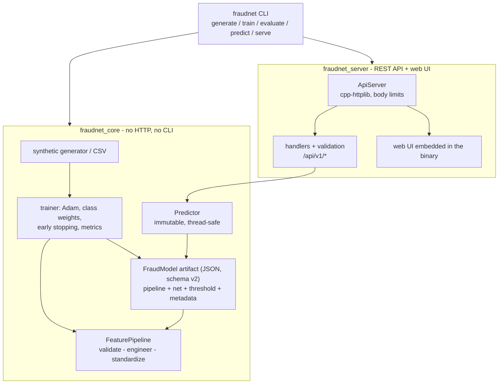

# FraudNet

A fraud-detection machine-learning model **written from scratch in C++20** (no ML libraries), trained on
synthetic credit-card transactions and deployed behind a REST API with a polished web console.

* Feed-forward neural network (dense layers, ReLU, sigmoid output, class-weighted binary cross-entropy,
  mini-batch **Adam**, early stopping) plus a **logistic-regression baseline** trained by the same code.
* Seeded synthetic data generator with ~2 % fraud, including a non-linear "card testing" pattern.
* Metrics implemented by hand: precision, recall, F1, ROC-AUC, PR-AUC, confusion matrix, F1-optimal threshold.
* Model = one JSON file (weights + scaler + threshold + metrics); a trained model is committed in `models/`.
* `fraudnet serve` exposes a validated JSON API and a single-page UI (light/dark, responsive, accessible,
  no CDN, no external assets).
* 63 GoogleTest cases (~2 s): numerical gradient check, metric correctness, strict model-schema validation,
  training/serving feature parity, concurrent-prediction consistency, HTTP integration (limits, versioned
  routes, embedded UI) and seeded-reproducibility checks. Inference tests use a tiny committed model so they
  stay fast and independent of the trainer.

## Architecture



Design rules (see [ARCHITECTURE_REVIEW.md](ARCHITECTURE_REVIEW.md) for the full review and decisions):

* **Dependency direction** is enforced by CMake targets: `fraudnet_core` (data, features, model, training,
  inference) knows nothing about HTTP or the CLI; `fraudnet_server` depends on core; the `fraudnet` executable
  depends on both.
* **One feature pipeline.** `FeaturePipeline` (validate, engineer 11 inputs into 22 columns, standardize) is the
  only way to turn a transaction into network input. Training builds its matrices with the same per-row call the
  server uses, so training/serving skew cannot creep in; a test checks this bit for bit.
* **Immutable inference.** The server owns a `Predictor` (`shared_ptr<const FraudModel>`), so concurrent
  requests need no locks.
* **Strict model artifact.** `schema_version`, the ordered feature list, the one-hot category order, scaler,
  network and threshold are all validated on load; a mismatch fails with a precise message instead of
  silently mis-scoring.
* **Self-contained binary.** The UI is compiled in at build time, so `fraudnet.exe` runs from any directory.

Source layout (`src/`):

| Path | Purpose |
| --- | --- |
| `core/generator.*`, `core/csv.*` | Synthetic transactions, CSV read/write with line-numbered errors |
| `core/features.*`, `core/feature_pipeline.*` | Feature definitions and domain checks; the single raw -> network-input pipeline |
| `core/scaler.*`, `core/mlp.*`, `core/trainer.*`, `core/numeric.hpp` | Standardization, network with analytic back-propagation, Adam trainer, stable sigmoid/softplus |
| `core/metrics.*` | Confusion matrix, ROC/PR AUC, curves, threshold search |
| `core/model.*`, `core/predictor.*`, `core/pipeline.*` | Model artifact (strict JSON I/O), immutable inference + explanations, end-to-end training pipeline |
| `server/api.*`, `server/server.*`, `server/ui_assets.*` | Validation + JSON handlers, HTTP server (versioned routes, limits), embedded UI |
| `cli/main.cpp` | CLI (`generate`, `train`, `evaluate`, `predict`, `serve`) |
| `ui/` | `index.html`, `style.css`, `app.js` (vanilla); embedded into the binary at build time |
| `cmake/embed_ui.cmake` | Build-time generator for the embedded UI (pure CMake, no extra tools) |

### Model file format

`models/fraudnet.json` is a single JSON document: `format` (`fraudnet-model`), `schema_version` (`2`), ordered
`features` and `categories`, `scaler` (mean/std), `network` (layer sizes, weights, biases, activations),
`threshold`, plus metadata (`version`, `created_at`, `training` config with seeds, `metrics` incl. ROC/PR
curves). Loading checks all of it; models from an older/newer schema are rejected with a clear error.

## Model card

| | |
| --- | --- |
| Task | Binary classification: is this card transaction fraudulent? |
| Data | 120,000 synthetic transactions (seed 42), 1.97 % fraud. Split stratified 84,000 train / 18,000 validation / 18,000 test |
| Inputs | amount, hour, merchant category (10), distance from home, distance from last txn, txns in last 1 h / 24 h, 30-day average amount, card present, foreign merchant, account age |
| Model | MLP 22 -> 32 -> 16 -> 1 (1,281 parameters), ReLU, Adam (lr 0.003, batch 256, L2 1e-5), fraud class weight 7.05 (= sqrt(neg/pos)) |
| Early stopping | validation PR-AUC, patience 8; best epoch 8 of 16 |
| Threshold | 0.9074, chosen to maximize F1 on the **validation** set |

Retrained with v1.1.0 (model schema 2); training is fully seeded, so the metrics reproduced the v1.0.0 numbers exactly.

Held-out **test set** (18,000 transactions, 355 fraud), threshold 0.9074:

| Metric | Neural network | Logistic regression baseline |
| --- | --- | --- |
| ROC-AUC | **0.9898** | 0.9889 |
| PR-AUC | **0.9028** | 0.8759 |
| F1 | **0.8430** | 0.8167 |
| Precision | **0.8981** | 0.8373 |
| Recall | 0.7944 | 0.7972 |

Confusion matrix (NN, test): TN 17,613 / FP 32 / FN 73 / TP 282.

Limitations: the data is synthetic and its fraud patterns are simple by construction; the numbers above say
how well the pipeline works, **not** how it would perform on real card traffic. Explanations use occlusion
(replace one input by its training mean and measure the change in log-odds), which is a local approximation.

## Build

Requires CMake >= 3.25 (for presets; the project itself needs 3.20) and a C++20 compiler (developed with
Visual Studio 2022 Build Tools / MSVC 19.44). Dependencies (nlohmann/json, cpp-httplib, GoogleTest) are
fetched from their official GitHub repos by CMake.

```powershell
cmake --preset msvc                      # Windows; use `release` (Ninja) on Linux/macOS
cmake --build --preset msvc-release
ctest --preset msvc-release              # 63 tests, ~2 s
cmake --install build/msvc --config Release --prefix dist    # fraudnet.exe + model + docs
```

Without presets: `cmake -S . -B build -G "Visual Studio 17 2022" -A x64` then `cmake --build build --config Release`.
Options: `-DFRAUDNET_BUILD_TESTS=OFF` skips GoogleTest, `-DFRAUDNET_WARNINGS_AS_ERRORS=ON` (preset `msvc-strict`)
turns warnings into errors. All FraudNet code builds warning-free at `/W4` (`-Wall -Wextra -Wpedantic` elsewhere).

## Run

```powershell
$fn = ".\build\msvc\Release\fraudnet.exe"
& $fn --version
& $fn generate --rows 120000 --seed 42 --out data/transactions.csv
& $fn train --data data/transactions.csv --out models/fraudnet.json
& $fn evaluate --model models/fraudnet.json --data data/transactions.csv --split test
& $fn predict --json '{"amount":900,"hour":3,"merchant_category":"electronics","distance_from_home_km":800,"distance_from_last_txn_km":400,"txn_count_1h":4,"txn_count_24h":8,"avg_amount_30d":45,"card_present":false,"is_foreign":true,"account_age_days":20}'
& $fn serve --port 8080          # open http://127.0.0.1:8080
```

The web UI is **embedded in the executable**, so it can be copied and run from any directory. When `--model`
is omitted the model is looked up in `$FRAUDNET_MODEL`, then `models/fraudnet.json` near the working directory
or executable, then `<prefix>/share/fraudnet/models/` (installed layout). `serve` only binds to `127.0.0.1`;
`--ui DIR` serves the UI from a folder instead (handy while editing `ui/`), `--no-ui` serves the API only. Run
`fraudnet --help` for all options, e.g. `train --hidden 64,32 --lr 0.002 --epochs 100 --patience 10 --class-weight 10`.

## Web UI

* **Analyze** - sliders/inputs for every field, preset examples, live probability gauge with the decision
  threshold marker, and diverging bars that explain the score.
* **Model** - metric cards, confusion matrix, ROC curve, precision-recall curve, training history,
  baseline comparison and model card (all drawn as inline SVG).
* **Batch** - upload a CSV (drag & drop), sortable/paginated results, flagged-only filter, download scored
  CSV; if the file has an `is_fraud` column precision/recall are computed in the browser.

## API

All bodies are JSON. Routes are versioned under `/api/v1`; the old unversioned `/api/*` paths still work as aliases but answer with `Deprecation: true` and a `Link` to the successor. Request bodies are limited (64 KiB for `predict`, 4 MiB for `predict/batch`; HTTP 413) and must be `application/json` (HTTP 415). Errors use `{"error": "<code>", "message": "...", "details": [...]}`.

```powershell
curl http://127.0.0.1:8080/api/v1/health
curl http://127.0.0.1:8080/api/v1/model

curl -X POST http://127.0.0.1:8080/api/v1/predict -H "Content-Type: application/json" -d '{
  "amount": 900, "hour": 3, "merchant_category": "electronics",
  "distance_from_home_km": 800, "distance_from_last_txn_km": 400,
  "txn_count_1h": 4, "txn_count_24h": 8, "avg_amount_30d": 45,
  "card_present": false, "is_foreign": true, "account_age_days": 20 }'
```

```json
{
  "probability": 0.99999989, "is_fraud": true, "label": "fraud", "risk_level": "high", "threshold": 0.9074,
  "top_features": [
    { "feature": "amount_vs_30d_avg", "value": 20.0, "contribution": 2.94, "direction": "increases_risk" },
    { "feature": "distance_from_home_km", "value": 800.0, "contribution": 2.64, "direction": "increases_risk" }
  ]
}
```

| Endpoint | Description |
| --- | --- |
| `GET /api/v1/health` | Status, server/model version, uptime |
| `GET /api/v1/model` | Version, threshold, test/validation metrics, ROC/PR curves, training info, input schema |
| `POST /api/v1/predict` | One transaction -> probability, label, risk level, top-5 contributing features |
| `POST /api/v1/predict/batch` | `{"transactions": [...]}` (or a bare array, max 10,000) -> per-row results and flagged count |

Validation reports every problem at once, e.g. `POST /api/v1/predict` with `{"amount": -5, "hour": 25}` returns
HTTP 400 with `details` such as `amount: must be between 0 and 10000000 (got -5)` and
`merchant_category: required field is missing`. Batch errors are prefixed with the row, e.g.
`transactions[1].hour: ...`. Unknown fields are rejected.

## Project layout

```
CMakeLists.txt  CMakePresets.json  cmake/  src/{core,server,cli}/  tests/  tests/data/test_model.json
ui/  models/fraudnet.json  data/sample_transactions.csv  ARCHITECTURE_REVIEW.md  CHANGELOG.md
```

`data/transactions.csv` is generated locally and git-ignored; `data/sample_transactions.csv` (150 rows) is
a small file you can upload on the Batch page.
