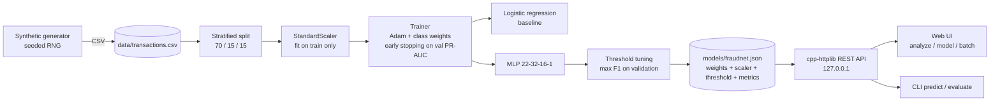

# FraudNet

A fraud-detection machine-learning model **written from scratch in C++20** (no ML libraries), trained on
synthetic credit-card transactions and deployed behind a REST API with a polished web console.

* Feed-forward neural network (dense layers, ReLU, sigmoid output, class-weighted binary cross-entropy,
  mini-batch **Adam**, early stopping) plus a **logistic-regression baseline** trained by the same code.
* Seeded synthetic data generator with ~2 % fraud, including a non-linear "card testing" pattern.
* Metrics implemented by hand: precision, recall, F1, ROC-AUC, PR-AUC, confusion matrix, F1-optimal threshold.
* Model = one JSON file (weights + scaler + threshold + metrics); a trained model is committed in `models/`.
* `fraudnet serve` exposes a validated JSON API and a single-page UI (light/dark, responsive, accessible,
  no CDN, no external assets).
* 40 GoogleTest cases incl. a numerical gradient check, metric correctness on known inputs, scaler,
  serialization round-trip, HTTP integration and an AUC > 0.9 training test.

## Architecture



Source layout (`src/`):

| File | Purpose |
| --- | --- |
| `generator.*`, `csv.*` | Synthetic transactions, CSV read/write with line-numbered errors |
| `features.*` | 11 raw inputs -> 22 engineered columns; feature groups used for explanations |
| `scaler.*`, `mlp.*`, `trainer.*` | Standardization, network with analytic back-propagation, Adam trainer |
| `metrics.*` | Confusion matrix, ROC/PR AUC, curves, threshold search |
| `model.*`, `pipeline.*` | Deployable model (JSON I/O, explanations), end-to-end training pipeline |
| `api.*`, `server.*` | Input validation + JSON handlers, HTTP server and static UI hosting |
| `main.cpp` | CLI (`generate`, `train`, `evaluate`, `predict`, `serve`) |
| `ui/` | `index.html`, `style.css`, `app.js` (vanilla, served by `serve`) |

## Model card

| | |
| --- | --- |
| Task | Binary classification: is this card transaction fraudulent? |
| Data | 120,000 synthetic transactions (seed 42), 1.97 % fraud. Split stratified 84,000 train / 18,000 validation / 18,000 test |
| Inputs | amount, hour, merchant category (10), distance from home, distance from last txn, txns in last 1 h / 24 h, 30-day average amount, card present, foreign merchant, account age |
| Model | MLP 22 -> 32 -> 16 -> 1 (1,281 parameters), ReLU, Adam (lr 0.003, batch 256, L2 1e-5), fraud class weight 7.05 (= sqrt(neg/pos)) |
| Early stopping | validation PR-AUC, patience 8; best epoch 8 of 16 |
| Threshold | 0.9074, chosen to maximize F1 on the **validation** set |

Held-out **test set** (18,000 transactions, 355 fraud), threshold 0.9074:

| Metric | Neural network | Logistic regression baseline |
| --- | --- | --- |
| ROC-AUC | **0.9898** | 0.9889 |
| PR-AUC | **0.9028** | 0.8759 |
| F1 | **0.8430** | 0.8167 |
| Precision | **0.8981** | 0.8373 |
| Recall | 0.7944 | 0.7972 |

Confusion matrix (NN, test): TN 17,613 / FP 32 / FN 73 / TP 282.

Limitations: the data is synthetic and its fraud patterns are simple by construction; the numbers above say
how well the pipeline works, **not** how it would perform on real card traffic. Explanations use occlusion
(replace one input by its training mean and measure the change in log-odds), which is a local approximation.

## Build

Requires CMake >= 3.20 and a C++20 compiler (developed with Visual Studio 2022 Build Tools / MSVC 19.44).
Dependencies (nlohmann/json, cpp-httplib, GoogleTest) are fetched from their official GitHub repos by CMake.

```powershell
cmake -S . -B build -G "Visual Studio 17 2022" -A x64
cmake --build build --config Release
ctest --test-dir build -C Release --output-on-failure
```

The code builds warning-free at `/W4` (`-Wall -Wextra -Wpedantic` on other compilers).

## Run

```powershell
$fn = ".\build\Release\fraudnet.exe"
& $fn --version
& $fn generate --rows 120000 --seed 42 --out data/transactions.csv
& $fn train --data data/transactions.csv --out models/fraudnet.json
& $fn evaluate --model models/fraudnet.json --data data/transactions.csv --split test
& $fn predict --json '{"amount":900,"hour":3,"merchant_category":"electronics","distance_from_home_km":800,"distance_from_last_txn_km":400,"txn_count_1h":4,"txn_count_24h":8,"avg_amount_30d":45,"card_present":false,"is_foreign":true,"account_age_days":20}'
& $fn serve --port 8080          # open http://127.0.0.1:8080
```

`serve` finds `models/fraudnet.json` and `ui/` relative to the working directory or the executable (override
with `--model` / `--ui`). It only binds to `127.0.0.1`. Run `fraudnet --help` for all options, e.g.
`train --hidden 64,32 --lr 0.002 --epochs 100 --patience 10 --class-weight 10`.

## Web UI

* **Analyze** - sliders/inputs for every field, preset examples, live probability gauge with the decision
  threshold marker, and diverging bars that explain the score.
* **Model** - metric cards, confusion matrix, ROC curve, precision-recall curve, training history,
  baseline comparison and model card (all drawn as inline SVG).
* **Batch** - upload a CSV (drag & drop), sortable/paginated results, flagged-only filter, download scored
  CSV; if the file has an `is_fraud` column precision/recall are computed in the browser.

## API

All bodies are JSON. Errors use `{"error": "<code>", "message": "...", "details": [...]}`.

```powershell
curl http://127.0.0.1:8080/api/health
curl http://127.0.0.1:8080/api/model

curl -X POST http://127.0.0.1:8080/api/predict -H "Content-Type: application/json" -d '{
  "amount": 900, "hour": 3, "merchant_category": "electronics",
  "distance_from_home_km": 800, "distance_from_last_txn_km": 400,
  "txn_count_1h": 4, "txn_count_24h": 8, "avg_amount_30d": 45,
  "card_present": false, "is_foreign": true, "account_age_days": 20 }'
```

```json
{
  "probability": 0.99999989, "is_fraud": true, "label": "fraud", "risk_level": "high", "threshold": 0.9074,
  "top_features": [
    { "feature": "amount_vs_30d_avg", "value": 20.0, "contribution": 2.94, "direction": "increases_risk" },
    { "feature": "distance_from_home_km", "value": 800.0, "contribution": 2.64, "direction": "increases_risk" }
  ]
}
```

| Endpoint | Description |
| --- | --- |
| `GET /api/health` | Status, server/model version, uptime |
| `GET /api/model` | Version, threshold, test/validation metrics, ROC/PR curves, training info, input schema |
| `POST /api/predict` | One transaction -> probability, label, risk level, top-5 contributing features |
| `POST /api/predict/batch` | `{"transactions": [...]}` (or a bare array, max 10,000) -> per-row results and flagged count |

Validation reports every problem at once, e.g. `POST /api/predict` with `{"amount": -5, "hour": 25}` returns
HTTP 400 with `details` such as `amount: must be between 0 and 10000000 (got -5)` and
`merchant_category: required field is missing`. Batch errors are prefixed with the row, e.g.
`transactions[1].hour: ...`. Unknown fields are rejected.

## Project layout

```
CMakeLists.txt  src/  tests/  ui/  models/fraudnet.json  data/sample_transactions.csv  CHANGELOG.md
```

`data/transactions.csv` is generated locally and git-ignored; `data/sample_transactions.csv` (150 rows) is
a small file you can upload on the Batch page.
